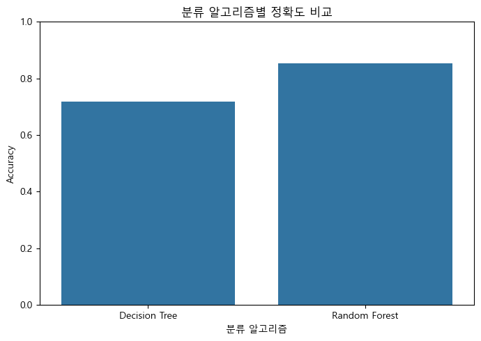
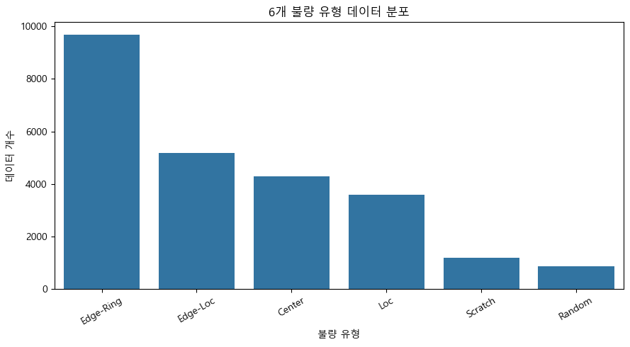
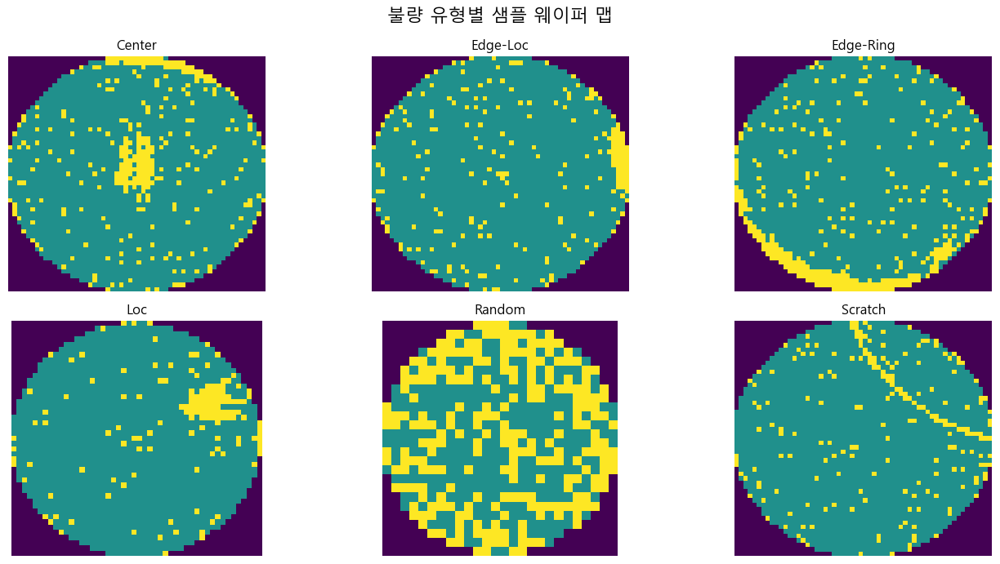
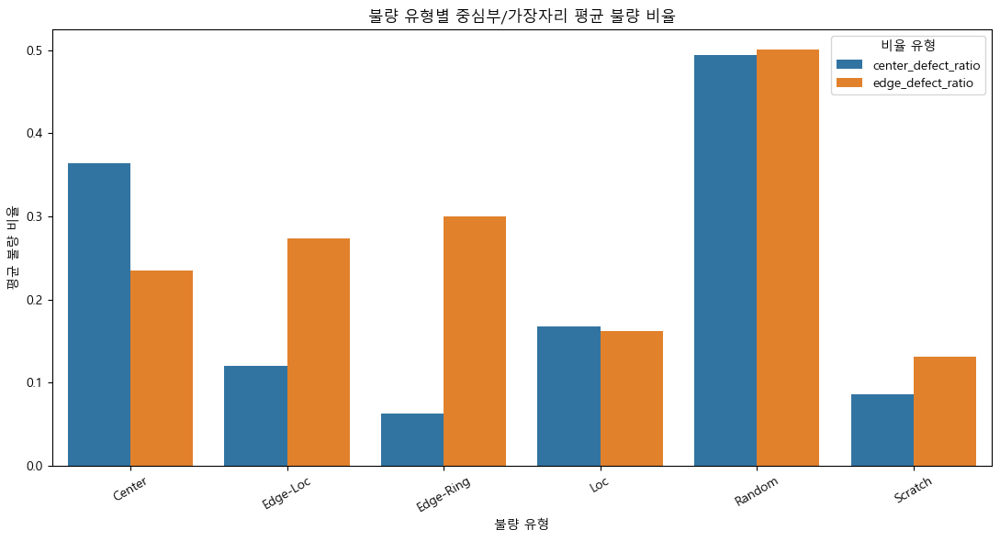
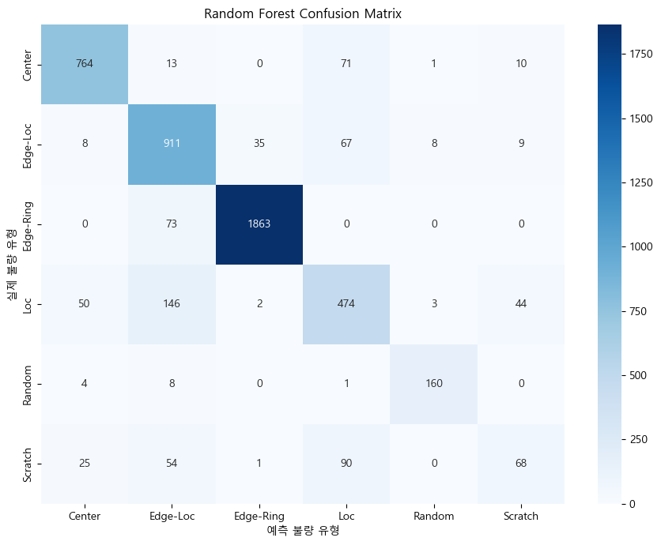
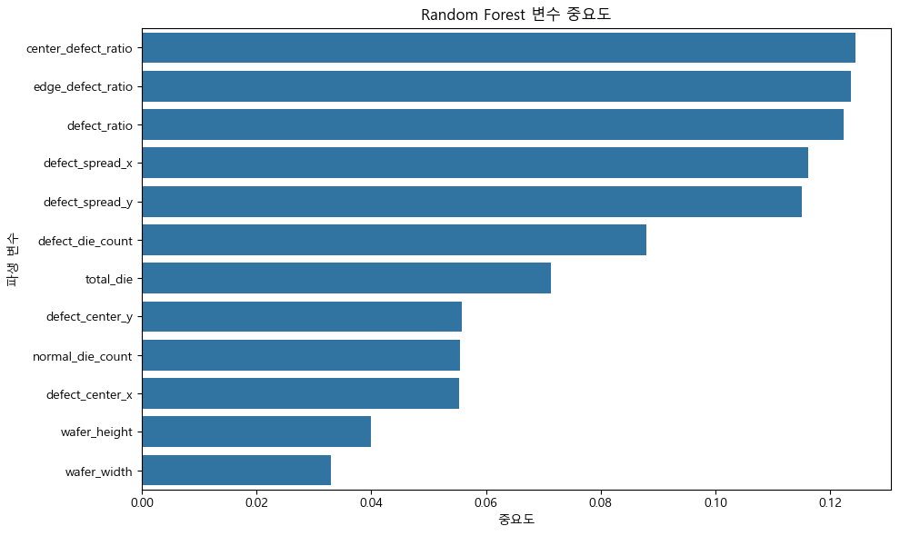

# Wafer Defect Analysis

WM-811K 웨이퍼 맵의 불량 위치와 분포를 분석하고, 주요 불량 패턴을 분류한 데이터 분석 프로젝트입니다. 이미지 형태의 웨이퍼 맵을 수치형 특성으로 변환하여 공정 품질 데이터를 어떻게 탐색하고 모델링할 수 있는지 확인했습니다.

## 문제 정의

웨이퍼 불량은 발생 위치와 분포 형태에 따라 서로 다른 패턴을 보입니다. 이 프로젝트는 다음 질문에 답하는 것을 목표로 합니다.

1. 불량 유형별 위치·분포 특성은 어떻게 다른가?
2. 불량 비율과 중심·가장자리 위치 정보를 수치화할 수 있는가?
3. 생성한 특성만으로 주요 불량 유형을 어느 정도 분류할 수 있는가?

## 데이터

- Dataset: WM-811K Wafer Map Dataset
- 전체 데이터: 811,457개 웨이퍼
- 불량 유형 라벨이 있는 데이터: 172,950개
- 불량 패턴 데이터: 25,519개
- 모델링 데이터: 24,815개, 6개 클래스
- 클래스: Center, Edge-Loc, Edge-Ring, Loc, Random, Scratch

원본 `LSWMD.pkl`은 파일 크기와 배포 조건 때문에 저장소에 포함하지 않았습니다. 실행 시 파일을 `data/LSWMD.pkl`에 직접 추가해야 합니다.

## 분석 과정

1. 배열 형태의 불량 라벨과 학습·테스트 라벨 정제
2. 정상·무패턴 데이터와 불량 패턴 데이터 분리
3. 클래스 분포와 대표 웨이퍼 맵 시각화
4. 웨이퍼 맵에서 12개 수치형 파생변수 생성
5. Decision Tree와 Random Forest 비교
6. 정확도, 클래스별 precision·recall·F1-score, 혼동행렬 평가

### 주요 파생변수

- 전체 die 수와 불량 die 수
- 불량 비율
- 불량 중심 X·Y 좌표
- 불량 분포의 X·Y 표준편차
- 중심부 불량 비율
- 가장자리 불량 비율

## 주요 결과

| 모델 | Accuracy |
|---|---:|
| Decision Tree | 71.69% |
| Random Forest | **85.43%** |





- 중심부·가장자리 불량 비율과 불량 분포 특성이 분류에 유의미하게 사용됐습니다.
- Edge-Ring과 Center처럼 위치 특성이 뚜렷한 유형은 상대적으로 잘 분류됐습니다.
- Scratch의 recall은 약 0.29로 낮아, 전체 정확도만으로 성능을 판단하면 소수 클래스를 놓칠 수 있음을 확인했습니다.









## 해석과 한계

- 클래스 불균형을 고려해 `class_weight="balanced"`를 사용했지만 Scratch 등 소수 클래스의 재현율은 여전히 낮습니다.
- 현재 결과는 클래스 비율을 유지한 무작위 학습·테스트 분할을 사용했습니다. 동일 lot의 웨이퍼가 양쪽에 포함될 수 있으므로 실제 일반화 성능 확인을 위해 lot 단위 그룹 분할이 필요합니다.
- 데이터가 매우 적은 Donut과 Near-full 클래스는 모델링에서 제외했습니다.
- 수작업 파생변수 기반 접근이므로 복잡한 형태 정보가 손실될 수 있습니다. 향후 CNN 기반 이미지 분류와 비교할 수 있습니다.
- 모델 결과는 불량 패턴 분류 가능성을 보여주지만 특정 공정 원인과의 인과관계를 직접 증명하지는 않습니다.

## 프로젝트 구조

```text
wafer-defect-analysis/
├── data/
│   └── .gitkeep
├── figures/
│   ├── class_distribution.png
│   ├── wafer_map_samples.png
│   ├── center_edge_ratio.png
│   ├── model_accuracy.png
│   ├── confusion_matrix.png
│   └── feature_importance.png
├── notebooks/
│   └── wafer_defect_analysis.ipynb
├── requirements.txt
├── .gitignore
└── README.md
```

## 실행 방법

```bash
git clone https://github.com/kaeru737/wafer-defect-analysis.git
cd wafer-defect-analysis
pip install -r requirements.txt
# data/LSWMD.pkl 추가
jupyter notebook notebooks/wafer_defect_analysis.ipynb
```

## 사용 기술

- Python, Jupyter Notebook
- pandas, NumPy
- Matplotlib, Seaborn
- scikit-learn
